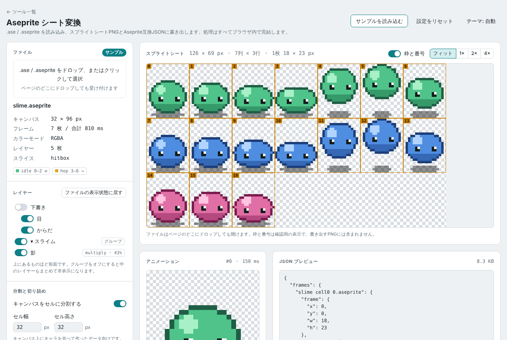
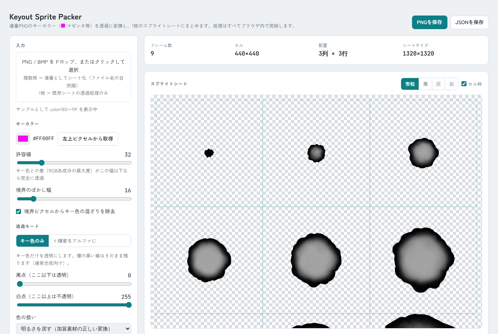
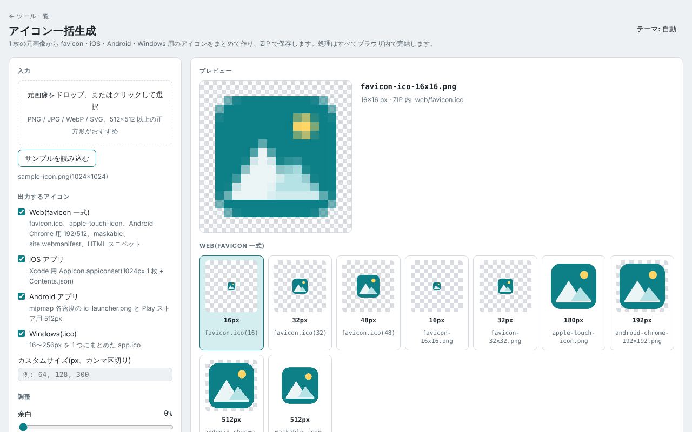
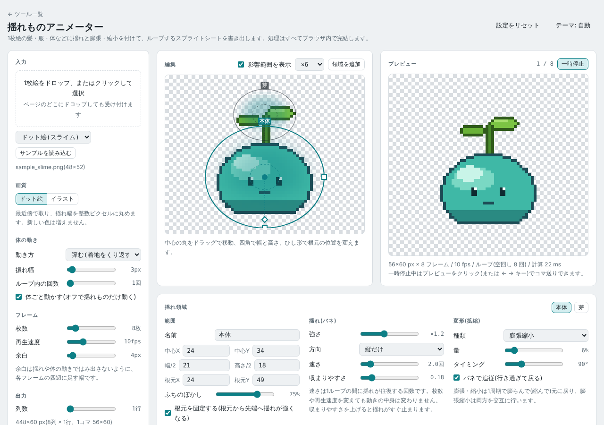
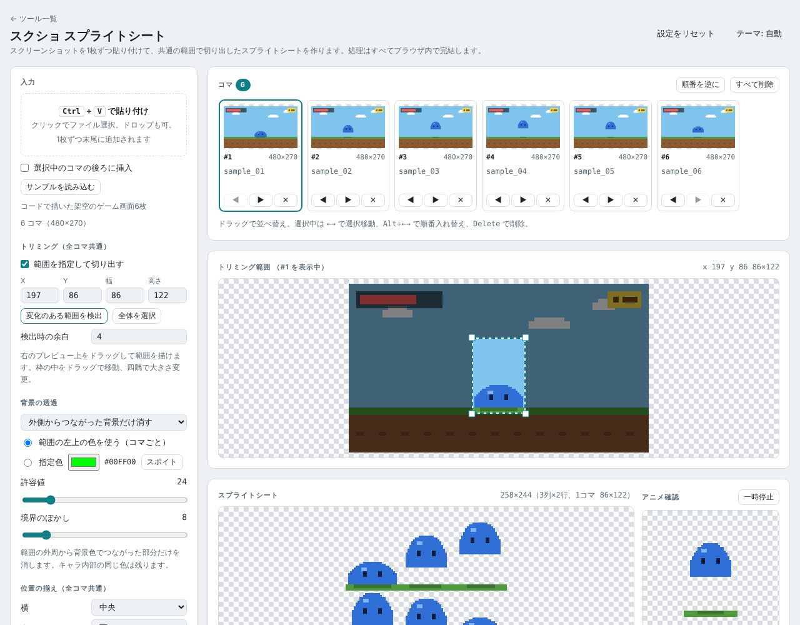
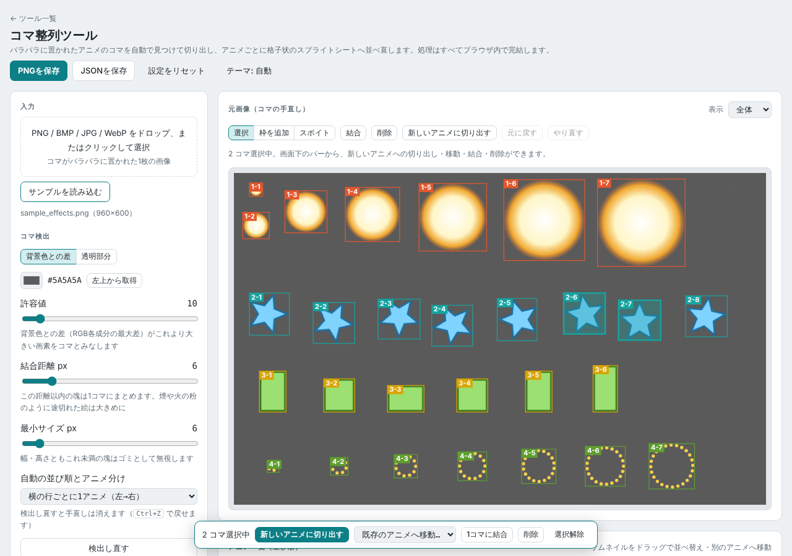
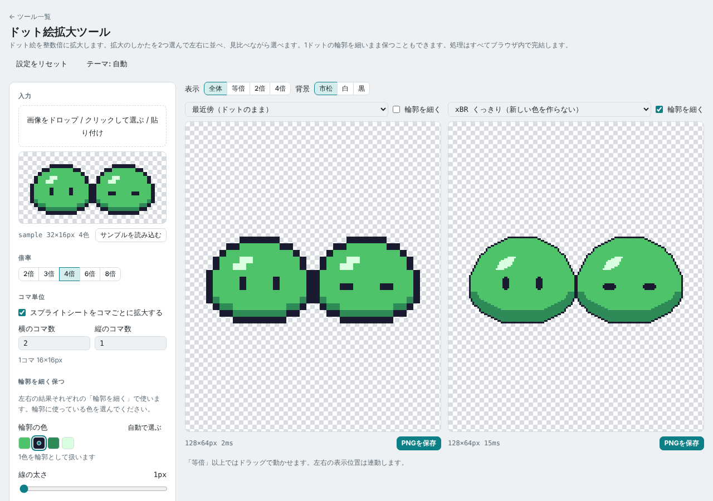
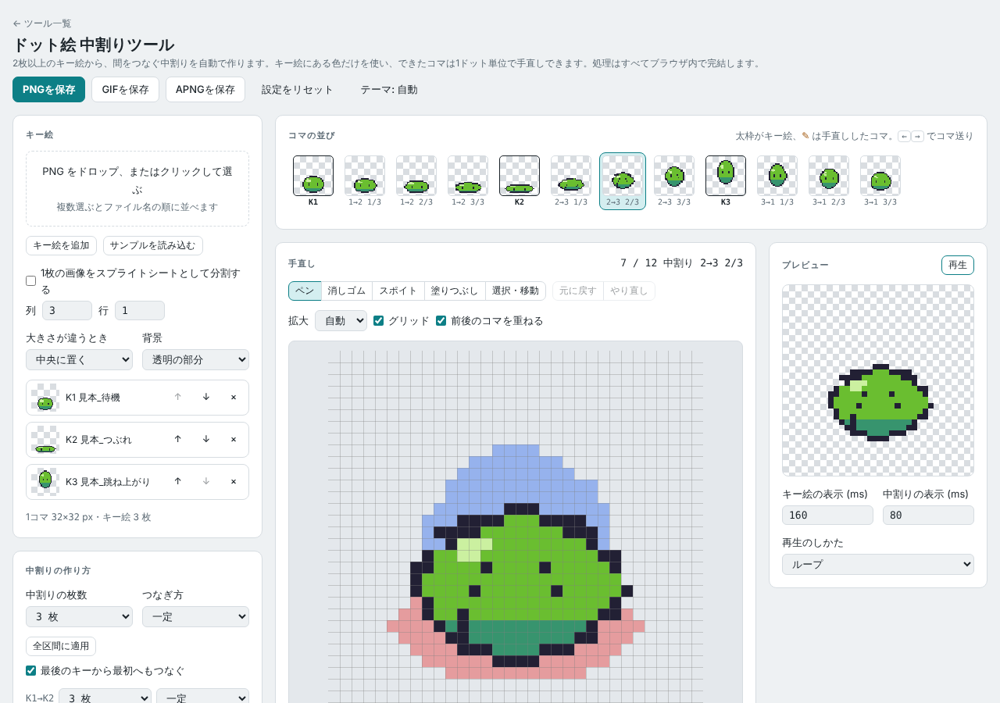
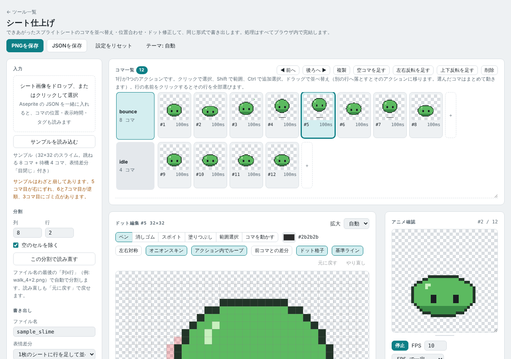

# ImageTools

ゲーム素材づくりなどで使う、画像処理系の小さなツール集です。
各ツールは **1つのHTMLファイルで完結** しており、使うだけならインストールは要りません。
公開ページは Vite でビルドした結果を GitHub Actions から配信しています(段階的な移行の計画は #37)。
画像の読み込みから書き出しまで、処理はすべてブラウザの中で行われます。フォントなどの読み込みで外部へアクセスすることはありますが、画像ファイルを送信することはありません。

- 公開ページ: https://ogsoonyn.github.io/ImageTools/ (GitHub Pages)

## ツール一覧

| ツール | 用途 | 入力 | 出力 | ファイル |
| --- | --- | --- | --- | --- |
| Aseprite シート変換 | Aseprite のファイルをスプライトシートに書き出す。レイヤーの表示切替、キャンバスのセル分割、余白の切り詰め、並べ方(横一列・縦一列・グリッド・セルごとに行)を指定できる | `.ase` / `.aseprite` | スプライトシート PNG + Aseprite 互換 JSON | [`tools/aseprite-sheet-converter.html`](tools/aseprite-sheet-converter.html) |
| Keyout Sprite Packer | キーカラー(マゼンタなど)を透過に変換し、連番画像を1枚のスプライトシートにまとめる。輝度をアルファに変える透過モードや、加算合成素材向けの色の扱いも選べる。1枚のシートを渡せば透過処理だけを行う | 連番 PNG / BMP、または既存のシート画像 | 透過済みスプライトシート PNG + JSON(独自形式、または Aseprite 互換の Hash / Array) | [`tools/keyout-sprite-packer.html`](tools/keyout-sprite-packer.html) |
| アイコン一括生成 | 1枚の元画像から favicon 一式(favicon.ico・apple-touch-icon・Android Chrome 用・maskable)、iOS(AppIcon 1024px)、Android(mipmap 各密度・Play ストア用)、Windows(.ico)、任意サイズのアイコンをまとめて作る。余白・角丸・背景色・縮小方式(なめらか / ドット絵向けニアレスト)を指定できる | PNG / JPG / WebP / SVG | ZIP(PNG・ICO・site.webmanifest・HTML スニペット・Contents.json)、または 1 枚ずつ PNG | [`tools/icon-generator.html`](tools/icon-generator.html) |
| 揺れものアニメーター | 1枚絵に楕円の揺れ領域を置き、体の動き(弾む・上下・左右・着地)に遅れて揺れるバネの動きと、膨張・縮小・膨張縮小の変形を付けたループアニメーションを作る。ドット絵モードでは揺れ幅を整数ピクセルに丸めて最近傍で取るので新しい色が増えない。再生速度や枚数を変えても動きの中身は変わらない | PNG / JPG / WebP など(1枚) | スプライトシート PNG + Aseprite 互換 JSON(Array) | [`tools/jiggle-animator.html`](tools/jiggle-animator.html) |
| スクショ スプライトシート | スクリーンショットを Ctrl+V で1枚ずつ貼り付け(ドロップ・ファイル選択も可)、並べ替え・削除したうえで、全コマ共通のトリミング範囲で切り出してスプライトシートにまとめる。コマ間で絵が変化している範囲の自動検出、背景色の透過(外側からつながった背景だけ / 指定色すべて)、透過後の絵の範囲での位置揃え(下端・上端・左端・右端・中央。コマ整列ツールと同じく、端で揃えたまとまりをセル中央に置く。セルを絵に合わせて詰めて余白を付けることも可)、コマごとの位置の微調整(前のコマを重ねて表示)ができる | クリップボードの画像 / PNG / JPG など(複数) | スプライトシート PNG + Aseprite 互換 JSON(Hash / Array) | [`tools/screenshot-sprite-sheet.html`](tools/screenshot-sprite-sheet.html) |
| コマ整列ツール | 1枚の画像にバラバラに置かれたアニメのコマを、背景色(または透明部分)との差と連結領域から自動で見つけて切り出し、アニメごとに格子状のスプライトシートへ並べ直す。結合距離で途切れた煙なども1コマにまとめられ、結合・削除・枠の追加や範囲調整・並べ替え・新しいアニメへの切り出しを手で直せる。コマはアニメ内で上下左右いずれかの端(または中央)に揃え、まとまり全体をセル中央に置く。背景は透過(境界のぼかし・色の混ざり除去つき)か背景色のまま | PNG / BMP / JPG / WebP(1枚) | スプライトシート PNG + Aseprite 互換 JSON(Hash / Array、アニメごとに frameTags) | [`tools/frame-sorter.html`](tools/frame-sorter.html) |
| ドット絵拡大ツール | ドット絵を整数倍(2・3・4・6・8倍)に拡大する。拡大のしかた(最近傍 / Scale2x・3x / xBR くっきり / xBR なめらか)を2つ選んで左右に並べ、表示位置を連動させて見比べられる。「輪郭を細く」を使うと、拡大で太くなる1ドットの輪郭を指定の太さ(初期値1ドット)に戻す。外側の輪郭は透明に接する側を残し、内側の線は中心線から太さを戻し、目のような小さな点は元の形のまま拡大する。輪郭の色は自動で選ばれ、パレットから選び直せる。スプライトシートはコマごとに別々に拡大して、隣のコマの色が境目ににじまないようにできる。縁に半透明のにじみは出さない | PNG / GIF / WebP など(1枚) | PNG | [`tools/pixel-upscaler.html`](tools/pixel-upscaler.html) |
| ドット絵 中割りツール | 2枚以上のキー絵から中割りを自動で作る。同じ色の画素どうしを、全体のずれ(重心・外接矩形)を差し引いた移動距離が小さくなるように結び、途中の位置を整数に丸めて置くので、キー絵にない色は出ない。つながった絵のかたまりごとの対応づけ、色が足りないときの近い色どうしの対応、数が合わない画素の扱い(近くへ寄せる / 途中で現れる・消える)、重なったときの優先、1ドットの穴埋めを選べる。区間ごとに枚数(1〜7)とつなぎ方(一定・ゆっくり始める・止まる・両方)を指定でき、最後のキーから最初へもつなげる。できたコマはペン・消しゴム・スポイト・塗りつぶし・選択移動で手直しでき(前後のコマを重ねて表示)、作り直すときは手直しを残すか選べる | PNG など(複数)、またはスプライトシート 1 枚を列数・行数で分割 | スプライトシート PNG、GIF、APNG(整数倍に拡大可) | [`tools/pixel-inbetween.html`](tools/pixel-inbetween.html) |
| シート仕上げ | できあがったスプライトシートを読み込み、コマ単位で直して同じ形式で書き出す。シートの1行を1つのアクションとして扱い、ドラッグでの並べ替え(別の行へ移す)・複製・反転コマの追加・コマごとの位置ずらし・下端/中央での一括の揃えができる。編集しながら再生するアニメ確認(FPS / コマごとの時間、往復、アクション別)、アクション内でループするオニオンスキンと前コマとの差分表示、横線・縦線の基準ライン、ペン・消しゴム・スポイト・塗りつぶし・範囲選択の移動とコピー・左右対称ペンでのドット修正を備える。表情などの差分は差分パーツとして別に持ち、コマごとの位置で重ねる(元の絵を直すと全差分に反映)。フィルタ(ぼかし・シャープ・アウトライン・明るさ/コントラスト・色相/彩度/明度・減色・色置換)は「色を増やさない」でシートにある色に寄せられる。セルの大きさ変更、背景透過、作業の保存と自動保存もできる | スプライトシート PNG など(ファイル名末尾の `_列x行` で分割、または手入力)。Aseprite 互換 JSON があればコマ位置・表示時間・タグも読む | スプライトシート PNG(末尾 `_列x行`)+ Aseprite 互換 JSON(アクションごとに frameTags)。差分は行を足すか別ファイル | [`tools/sprite-polish.html`](tools/sprite-polish.html) |

### Aseprite シート変換



### Keyout Sprite Packer



### アイコン一括生成



### 揺れものアニメーター



### スクショ スプライトシート



### コマ整列ツール



### ドット絵拡大ツール



### ドット絵 中割りツール



### シート仕上げ



## 使い方

次のどちらかで開きます。

1. **公開ページから開く**: https://ogsoonyn.github.io/ImageTools/ の一覧から使いたいツールを選びます。
2. **ローカルで開く**: リポジトリを clone(または ZIP でダウンロード)し、`tools/` にある HTML をブラウザで直接開きます。

開いたら、画像ファイルを画面にドラッグ&ドロップするか、ファイル選択ボタンから読み込みます。
設定を調整してプレビューを確認し、「PNGを保存」「JSONを保存」(アイコン一括生成は「ZIPで一括保存」)で書き出します。

### ツールをつないで使う

シートを作るツール(Aseprite シート変換・Keyout Sprite Packer・スクショ スプライトシート・コマ整列ツール)には「仕上げツールで開く」ボタンがあります。
押すと、いま作っているシート(PNG と Aseprite 互換 JSON)を保存せずに、シート仕上げツールの新しいタブへそのまま渡します。アクション名(frameTags)や表示時間も引き継ぎます。
ローカルの HTML を直接開いた場合も使えます(ポップアップがブロックされたときは、ブラウザの許可を確認してください)。

> [!NOTE]
> ローカルの HTML を `file://` で開いた場合、ブラウザの制限で、外部ファイルを読み込む機能(サンプル素材の読み込みなど)が使えないことがあります。ツール本体の処理は通常どおり使えます。

## 開発

ビルドには Node.js 22 以降と npm を使います。テストは Python(uv)です。

```bash
npm ci              # 初回のみ
npm run dev         # 開発サーバー(http://localhost:5173/)
npm run build       # 型チェックのあと dist/ に出力
npm run preview     # dist/ を配信して確認
```

`index.html` と `tools/*.html` はすべてビルドの入口になり、同じパスで `dist/` に出力されます。`samples/` もそのまま `dist/` にコピーされます。
`main` に push すると [`deploy.yml`](.github/workflows/deploy.yml) がビルドして GitHub Pages に公開します。

## ディレクトリ構成

```
ImageTools/
├── index.html   ツール一覧ページ(GitHub Pages のトップ)
├── tools/       各ツールの HTML(1ツール = 1ファイル)
├── templates/   新規ツール用のテンプレートと共通UIの仕様
├── samples/     ツールで試せるサンプル素材
├── tests/       Playwright のスモークテスト(PR ごとに GitHub Actions で実行)
├── .github/workflows/
│   ├── smoke.yml   ビルドしてスモークテストを実行
│   └── deploy.yml  ビルドして GitHub Pages に公開
├── package.json     ビルド用の npm 設定(Vite / TypeScript)
├── vite.config.ts   Vite の設定(入口の列挙、samples/ のコピー)
├── tsconfig.json
├── docs/
│   └── images/  README 用のスクリーンショット
├── .nojekyll    GitHub Pages で Jekyll 処理を無効にする
├── LICENSE
└── README.md
```

## 新しいツールを追加するには

1. [`templates/`](templates/) のテンプレートを `tools/` にコピーし、ファイル名を内容が分かる英小文字のケバブケースにします(例: `tools/palette-swapper.html`)。
2. テンプレートの共通ブロック(テーマ、ヘッダー、保存、ドラッグ&ドロップなど)はそのまま残し、ツール固有の処理を書き足します。共通ブロックの扱いは [`templates/README.md`](templates/README.md) を参照してください。
3. 外部のJS/CSS(Tailwind CDN を含む)は読み込まず、1ファイルで完結させます。既存ツールと同様、フォントは Google Fonts から読み込んで構いません。
4. この README の「ツール一覧」と、トップの一覧ページ(`index.html`)にツールを追加します。
5. スクリーンショットを `docs/images/<ツールのファイル名>.png` に置き、README に貼ります。
6. `uv run pytest` でスモークテストを実行し、コンソールのエラー/警告が出ないことを確認します。手順は [`tests/README.md`](tests/README.md) を参照してください(`tools/*.html` は自動でテスト対象になります。「PNGを保存」「JSONを保存」ボタンがあるツールには「サンプルを読み込む」ボタンも必要です)。

## ライセンスと素材の出所

- コード: [MIT License](LICENSE)
- フォント: [Google Fonts](https://fonts.google.com/) から読み込んでいます(いずれも [SIL Open Font License 1.1](https://openfontlicense.org/))。
  - Aseprite シート変換: DotGothic16 / IBM Plex Sans JP / JetBrains Mono
  - Keyout Sprite Packer: Zen Kaku Gothic New / JetBrains Mono
- サンプル素材: 出所とライセンスは [`samples/README.md`](samples/README.md) に記載します。
- Aseprite は [Igara Studio](https://www.aseprite.org/) の製品です。このリポジトリは Aseprite の公式ツールではありません。
